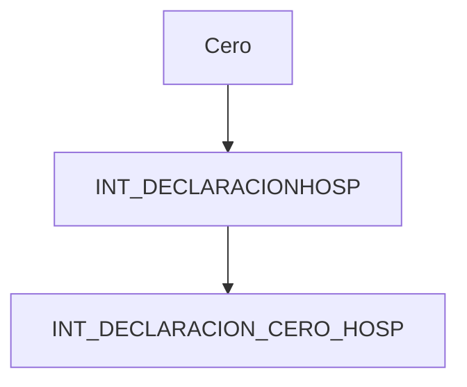

Esta declaración tiene mensual y cero

TIPO OPERSREV 110


## Declaración mensual

```sql
sql = " Insert into INT_DECLARACIONHOSP(";  
sql += "FOLIO,";  
sql += "FECHA_REG,";  
sql += "BASE,";  
sql += "IMPTOCARGO,";  
sql += "TOTALPAGAR,";  
sql += "ACTUALIZACION,";  
sql += "RECARGO,";  
sql += "IMPORTECOMP,";  
sql += "REC,";  
sql += "IDPERIODO,";  
sql += "IDEJERCICIO,";  
sql += "NUMCUARTOS,";  
sql += "IDESTADODEC,";  
sql += "IMPTOANT,";  
sql += "IDTIPODEC,";  
sql += "DFECHAANT,";  
sql += "TOTALAFAVOR,";  
sql += "REFERENCIA) ";  
sql += " values(?,SYSDATE,?,?,?,?,?,?,?,?,?,0,?,?,?,";  
if ((hosp.decimpComple > 0) && !((hosp.decfechaComple.equals("--/--/----")))) {  
    sql += "to_date('" + hosp.decfechaComple + "', 'dd-mm-yyyy'), ?, ?)";  
} else {  
    sql += "null, ?, ?)";  
}
```

## Declaración cero


```sql
sql = "INSERT INTO INT_DECLARACION_CERO_HOSP ("  
        + " FOLIO, REC, FECHA_REG, IDPERIODO, IDEJERCICIO, ID_INC_DEC_CERO, MOTIVO, IDTIPODEC)"  
        + " VALUES(?,?,SYSDATE,?,?,?,?,?)";
```


Cabe aclarar que la declaracion en cero tambien se graba en la tabla mensual, la fk es el folio





# consulta final propuesta

```SQL
SELECT  
    cat.PERIODO,       -- Año  
    cat.EJERCICIO,     -- Mes / Periodo  
    cat.FECHAHABIL     -- Fecha límite de pago  
FROM inc_calvigencias cat  
         LEFT JOIN (  
    --- SUBCONSULTA: PAGOS REALIZADOS (Optimizada) ---  
    SELECT DISTINCT PERIODO, EJERCICIO  
    FROM (  
             -- Parte 1: Declaraciones normales  
             SELECT distinct D.IDEJERCICIO+2000 AS PERIODO, D.IDPERIODO AS EJERCICIO  
             FROM INT_DECLARACIONHOSP D  
                      INNER JOIN INA_HOSPEDAJE H ON (D.FOLIO = H.FOLIO)           
                      INNER JOIN IT_SERVICIOS S ON (H.CLAVEPERIODO = S.CLAVEPERIODO AND H.CLAVEOPERACIONSERV = S.CLAVEOPERACIONSERV)  
                      INNER JOIN IT_CARGABANCO B ON (S.REFERENCIA = B.REFERENCIA and B.CLAVEESTADOCARGA = 2 OR B.CLAVEESTADOCARGA = 8)  
                      INNER JOIN INC_CALVIGENCIAS A  
                                 ON A.PERIODO = (D.IDEJERCICIO + 2000)  
                                     AND A.EJERCICIO = D.IDPERIODO  
                                     AND A.CLAVETIPOOPERSERV = 110
             WHERE D.REC = '00000522586'  -- <--- Movido aquí adentro para mejor rendimiento  
               AND D.IDESTADODEC =3  
               AND D.IDEJERCICIO > 13  
               AND D.FECHA_REG >= TIMESTAMP '2016-01-01 00:00:00'  
               AND D.IDPERIODO NOT IN (13,22)  
             UNION ALL  
             -- Parte 2: Declaraciones en cero  
             SELECT D.IDEJERCICIO+2000 AS PERIODO, D.IDPERIODO AS EJERCICIO  
             FROM INT_DECLARACION_CERO_HOSP D  
                      INNER JOIN INC_CALVIGENCIAS A  
                                 ON A.PERIODO = (D.IDEJERCICIO + 2000)  
                                     AND A.EJERCICIO = D.IDPERIODO  
                                     AND A.CLAVETIPOOPERSERV = 110
             WHERE D.REC = '00000522586'  -- <--- Movido aquí adentro para mejor rendimiento  
               AND D.IDEJERCICIO > 13  
               AND D.FECHA_REG >= TIMESTAMP '2016-01-01 00:00:00'  
               AND D.IDPERIODO NOT IN (13,22)  
         )   
) pagos  
                   ON cat.PERIODO = pagos.PERIODO  
                       AND cat.EJERCICIO = pagos.EJERCICIO  
WHERE cat.CLAVETIPOOPERSERV = 110 
  -- Nota: ADD_MONTHS es más exacto que 365*5 porque considera años bisiestos  
  AND cat.FECHAHABIL >= ADD_MONTHS(SYSDATE, -60)  
  AND pagos.PERIODO IS NULL  -- <--- CLAVE: Esto nos deja SOLO los que NO pagó  
  AND cat.ejercicio not in (13,22)  
ORDER BY cat.PERIODO, cat.EJERCICIO;
```